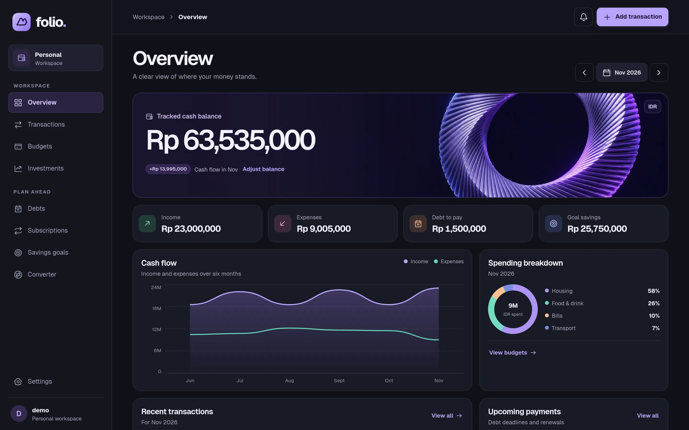
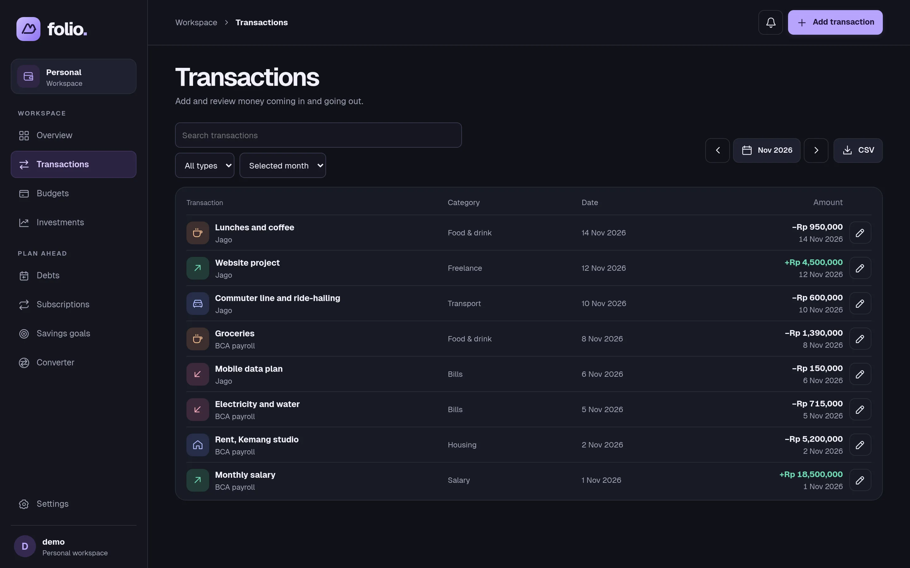
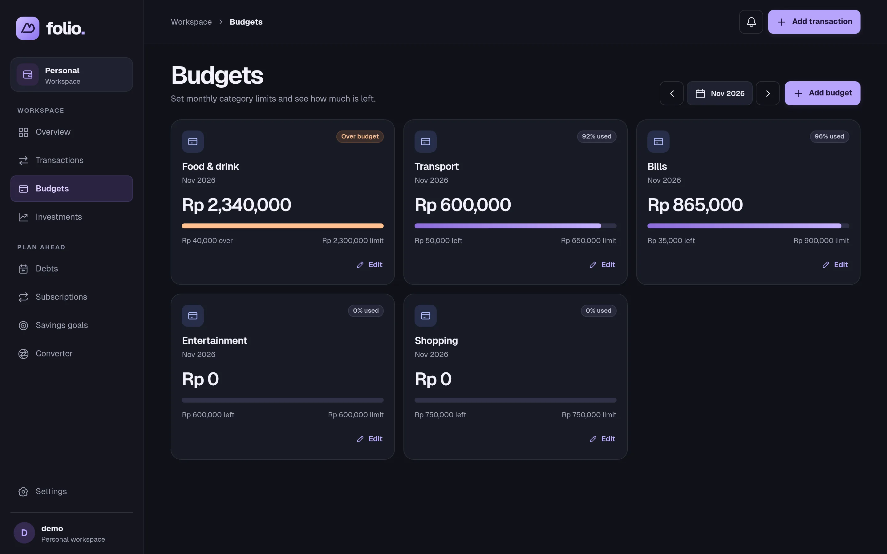
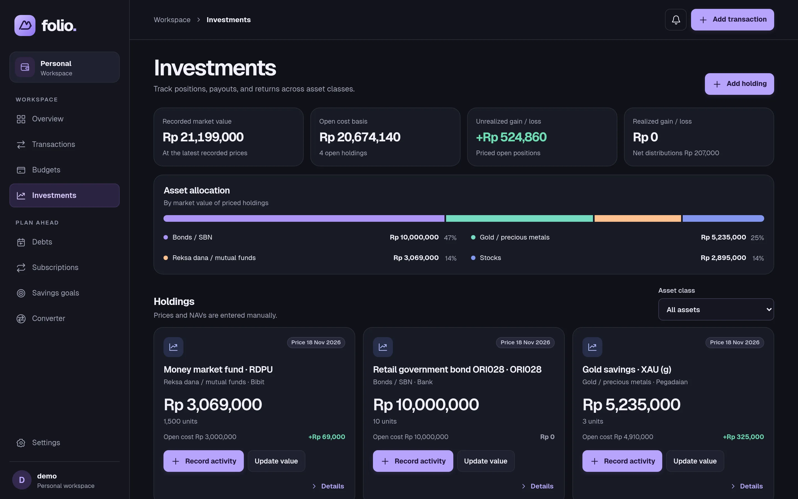
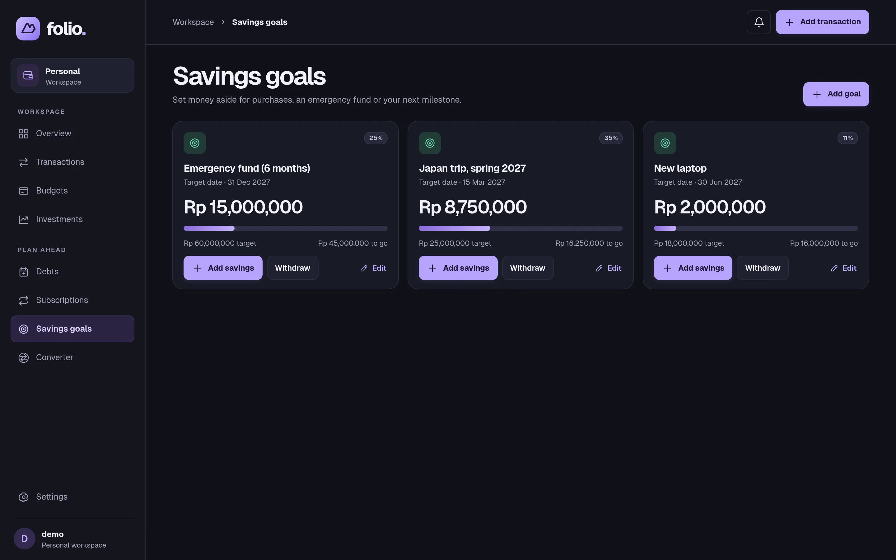
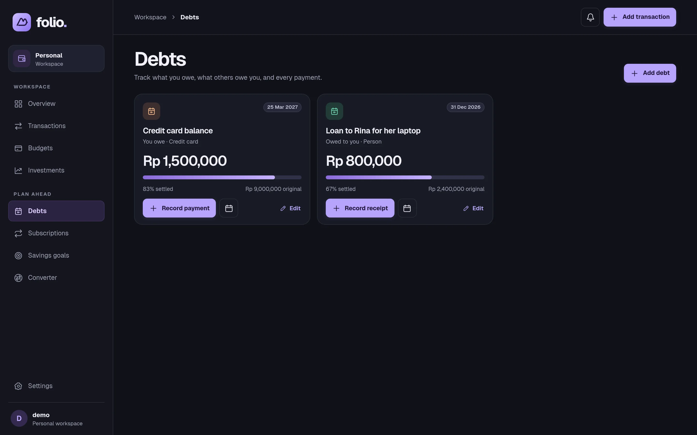
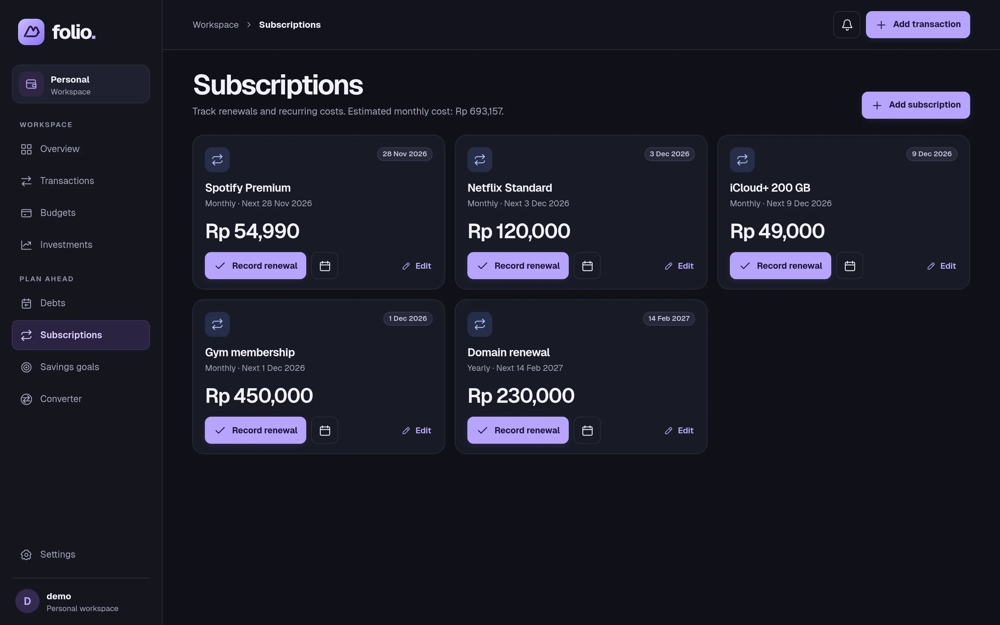
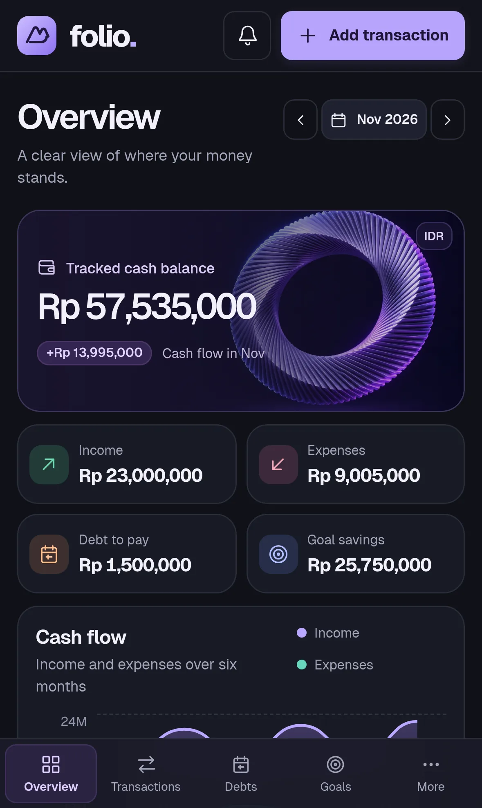
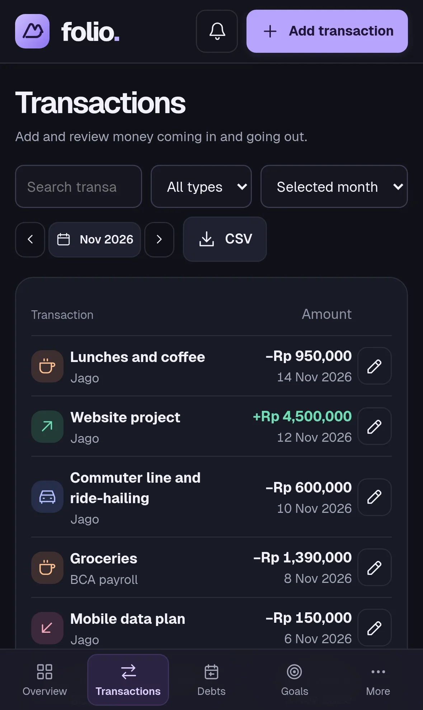
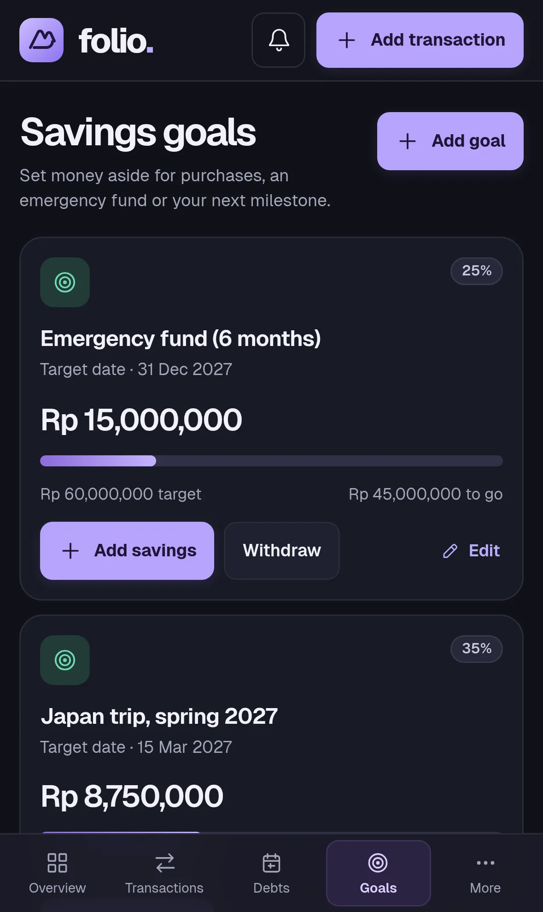

<div align="center">


# Folio

**A self-hosted personal finance workspace.** Track transactions, budgets, debts, subscriptions, savings goals and investments on your own server, and open it on your phone like an app.

[](https://github.com/Silent-Protocol-Inc/folio/actions/workflows/ci.yml)
[](https://github.com/Silent-Protocol-Inc/folio/releases)
[](LICENSE)
[](https://github.com/Silent-Protocol-Inc/folio/pkgs/container/folio)
[](https://nodejs.org)
[](https://sqlite.org)

[Quick start](#quick-start) · [Features](#features) · [Screenshots](#screenshots) · [Configuration](#configuration) · [Security](SECURITY.md)



<sub>Screenshots use the fictional sample workspace in <code>docs/demo/</code>.</sub>

</div>

## Features

- **Transactions and cash flow:** sort by date, value or name; set opening balances; record auditable corrections; and track income and expenses per source and category.
- **Tracked assets:** separate bank, e-money and cash sources, then see their balances together with priced stocks, crypto and other holdings in one global reporting currency.
- **Budgets:** monthly limits per category, with what is left at a glance.
- **Debts:** money you owe and money owed to you, with payments, due dates and reminders.
- **Subscriptions:** weekly, monthly and yearly renewals, paused or active, with upcoming payments.
- **Savings goals:** targets, deadlines, deposits and withdrawals.
- **Investments:** stocks, funds, bonds, gold, crypto and more, with cost basis, market value, realized and unrealized gain, and payouts.
- **Multi-currency:** 29 currencies and a converter with dated reference rates or your own rate.
- **Private by design:** mask dashboard totals, sign in with a discoverable passkey without typing an email, and keep one private workspace in one SQLite file with no third-party analytics.
- **Works on your phone:** add it to the home screen on iPhone or Android and it opens full screen.
- **Backups:** JSON export and import per account, plus a script for checked daily database backups.

## Quick start

One command installs Folio, starts it and creates your first account. Pick your system:

| System | Run this | Needs |
| --- | --- | --- |
| **Linux** (Ubuntu, Debian, Fedora, Arch, Alpine, …) | `curl -fsSL https://raw.githubusercontent.com/Silent-Protocol-Inc/folio/main/install.sh \| bash` | Docker, or Node.js 24 |
| **macOS** | `curl -fsSL https://raw.githubusercontent.com/Silent-Protocol-Inc/folio/main/install.sh \| bash` | Docker Desktop, or Node.js 24 (`brew install node`) |
| **Windows** (PowerShell) | `irm https://raw.githubusercontent.com/Silent-Protocol-Inc/folio/main/install.ps1 \| iex` | Docker Desktop |
| **Android** (Termux) | `pkg install -y curl && curl -fsSL https://raw.githubusercontent.com/Silent-Protocol-Inc/folio/main/install.sh \| bash` | nothing else; Node.js is installed for you |

The installer uses Docker when it finds it and otherwise installs Folio natively with Node.js. It asks for the install folder, the port, the address you will open Folio at, and your email; accept the defaults to use Folio on that device at <http://localhost:4173>. It prints a temporary password once: sign in with it and choose your own.

Native installs get a small control command in the install folder:

```sh
~/folio/folio status|start|stop|restart|logs|update
~/folio/folio add-user you@example.com
```

On Termux, run `termux-wake-lock` so Android keeps Folio running, and `~/folio/folio start` after a reboot.

Want to see Folio with data before entering your own? Sign in, open **Settings → Import backup** and pick [`docs/demo/demo-workspace.json`](docs/demo/demo-workspace.json).

<details>
<summary><b>Run on a server (HTTPS)</b></summary>

Folio only listens on `127.0.0.1`, so a reverse proxy serves it over HTTPS. Run the installer with your public address, for example `https://folio.example.com`, then point your proxy at the port you chose.

**Caddy** (gets the certificate for you):

```caddy
folio.example.com {
  reverse_proxy 127.0.0.1:4173 {
    header_up X-Folio-Client-IP {remote_host}
  }
}
```

**Nginx**, inside the HTTPS server block:

```nginx
location / {
    proxy_pass http://127.0.0.1:4173;
    proxy_set_header Host $host;
    proxy_set_header X-Folio-Client-IP $remote_addr;
}
```

The proxy must set `X-Folio-Client-IP` to the visitor address it trusts (Folio uses it for sign-in rate limits) and leave the `Origin` header untouched. Choose the final hostname before enrolling passkeys: passkeys only work on the hostname where they were created.

</details>

<details>
<summary><b>Install with Docker Compose by hand</b></summary>

```sh
git clone https://github.com/Silent-Protocol-Inc/folio.git && cd folio
cp .env.example .env && chmod 600 .env    # set FOLIO_ORIGIN and PORT
docker compose up -d                      # pulls ghcr.io/silent-protocol-inc/folio
docker compose exec folio node scripts/account.mjs you@example.com
```

Add `--build` to build the image from source instead of pulling it.

</details>

<details>
<summary><b>Run with Node.js, no Docker</b></summary>

Needs Node.js 24 or newer.

```sh
cp .env.example .env && chmod 600 .env    # set FOLIO_ORIGIN, PORT and FOLIO_DB_PATH
npm ci
npm run build
npm run account:add -- you@example.com
npm start
```

To run it as a service, adapt [`deploy/folio.service.example`](deploy/folio.service.example) (a systemd unit for a dedicated `folio` user), install it in `/etc/systemd/system/` and run `systemctl enable --now folio`.

</details>

## Screenshots

| Transactions | Budgets |
| --- | --- |
|  |  |
| **Investments** | **Savings goals** |
|  |  |
| **Debts** | **Subscriptions** |
|  |  |

<p align="center">
  
  
  
</p>

## Add to your phone

- **iPhone:** open your Folio address in Safari, tap **Share → Add to Home Screen**.
- **Android:** open it in Chrome and choose **Install app**.

It opens full screen with the Folio icon. Enroll a passkey under **Settings → Security** to sign in with Face ID or your fingerprint.

## Configuration

Set these in `.env`.

| Variable | Default | What it does |
| --- | --- | --- |
| `FOLIO_ORIGIN` | none (required) | The exact address you open Folio at, such as `https://folio.example.com`. HTTP is allowed only for `localhost`. |
| `PORT` | `4173` | Port Folio listens on. |
| `FOLIO_DB_PATH` | `./data/folio.sqlite` | SQLite database file (Node.js install). Docker always uses `/data/folio.sqlite`. |
| `FOLIO_DATA_DIR` | `./data` | Docker: host folder that holds the database. |
| `FOLIO_HOST` | `127.0.0.1` | Listen address. The Docker image sets `0.0.0.0` inside the container and publishes the port on the host's `127.0.0.1` only. |
| `FOLIO_UID` / `FOLIO_GID` | `1000` | Docker: user the container runs as; it must own `FOLIO_DATA_DIR`. |
| `FOLIO_IMAGE` | `ghcr.io/silent-protocol-inc/folio:latest` | Docker: image to run, for example a pinned version such as `:1.1.0`. |

## Backups and upgrades

- **Per account:** **Settings → Export backup** saves a JSON file; **Import backup** restores it into any Folio account and replaces that account's workspace. Passwords, sessions and passkeys are not part of it.
- **Whole instance:** `deploy/backup.sh` makes a checked online backup of the SQLite file and keeps the newest 30 (needs `sqlite3` on the host):

  ```sh
  FOLIO_DB_PATH=./data/folio.sqlite BACKUP_DIR=./backups deploy/backup.sh
  ```

  Run it daily from cron and copy the backups off the server. They contain financial records and sign-in data, so keep them private.
- **Upgrade with Docker:** back up, then `docker compose pull && docker compose up -d`. Folio applies database migrations when it starts.
- **Upgrade with Node.js:** back up, replace the source, run `npm ci && npm run build`, then restart.

## Privacy

Folio sends nothing to third parties. The one outside request is optional: the currency converter asks [Frankfurter](https://frankfurter.dev) for an exchange rate, from your browser, when you use it.

## Documentation

| Document | For |
| --- | --- |
| [docs/ARCHITECTURE.md](docs/ARCHITECTURE.md) | How Folio works: source map, request flow, data model, security model, build |
| [docs/API.md](docs/API.md) | Every HTTP endpoint, with request and response shapes |
| [CONTRIBUTING.md](CONTRIBUTING.md) | Development setup, code style, the CI pipeline, releases |
| [CODE_OF_CONDUCT.md](CODE_OF_CONDUCT.md) | How we treat each other (Contributor Covenant 2.1) |
| [SUPPORT.md](SUPPORT.md) | Where to ask for help |
| [SECURITY.md](SECURITY.md) | Reporting vulnerabilities and running Folio safely |
| [CHANGELOG.md](CHANGELOG.md) | What changed in each release |

## Project layout

```
public/    HTML, CSS, browser code and icons
server/    request handler, authentication, workspace validation
scripts/   Node HTTP server, SQLite access, account tool, build
drizzle/   SQL migrations, applied on start
deploy/    reverse proxy and systemd examples, backup script
docs/      sample workspace and screenshots
```

## Contributing and contact

Bug reports and pull requests are welcome; see [CONTRIBUTING.md](CONTRIBUTING.md) for the development setup, the CI pipeline and how releases are made.

- Questions and feedback: **team@silentprotocol.top**
- Security issues: email **team@silentprotocol.top** instead of opening a public issue. See [SECURITY.md](SECURITY.md).

## License

Folio is licensed under the [Apache License 2.0](LICENSE). The bundled Geist typeface is licensed under the SIL Open Font License 1.1 ([licenses/Geist-OFL.txt](licenses/Geist-OFL.txt)). See [NOTICE](NOTICE).
